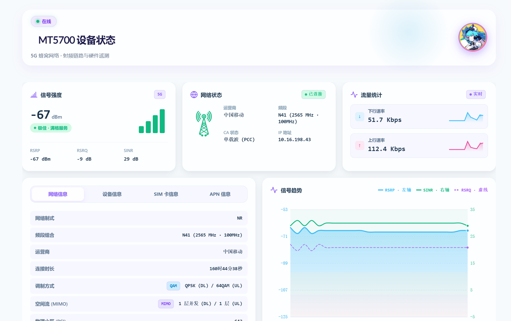
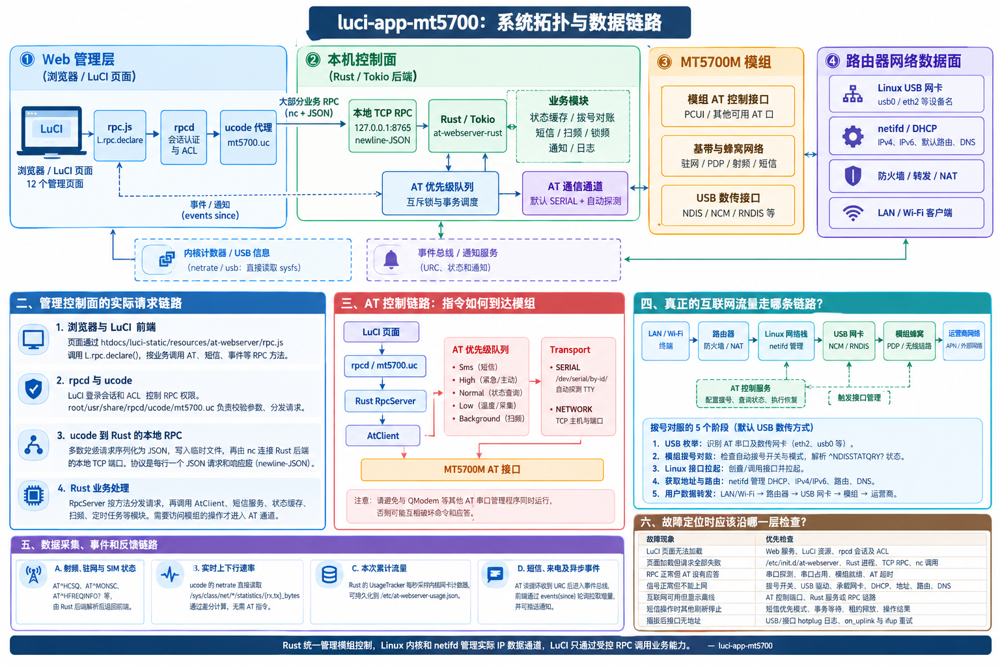
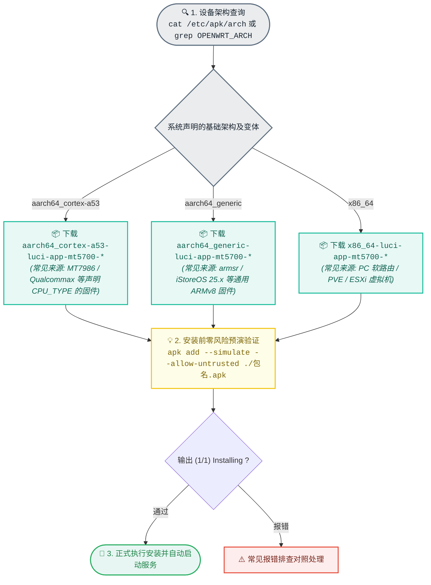
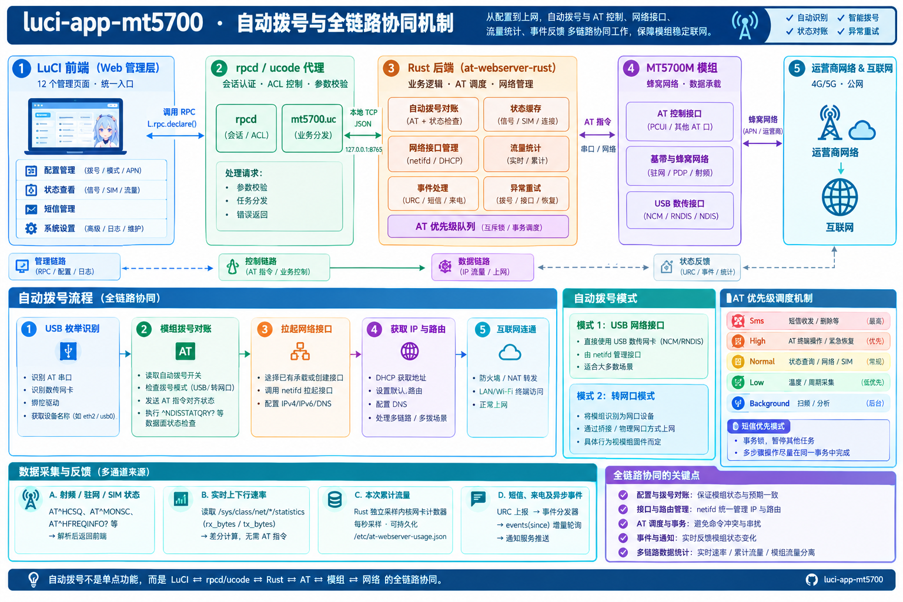

<div align="center">

# AT WebServer · MT5700M 5G 模组管理

OpenWrt / ImmortalWrt 平台下 MT5700M 5G 模组的全功能控制中心与守护套件

[](CHANGELOG.md)
[](https://openwrt.org/)
[](https://immortalwrt.org/)
[](src/rust/)
[](LICENSE)
[](https://lianxia233.github.io/luci-app-mt5700/)
[](https://github.com/LianXia233/luci-app-mt5700)
[](https://cnb.cool/LianXia233/luci-app-mt5700)

<p align="center">
  <b>单包融合交付</b>：集成 12 个原生 LuCI 现代化管理页面与高性能常驻后端 <code>/usr/bin/at-webserver-rust</code><br>
  涵盖全自动拨号对账、网络状态看板、全网扫频、智能锁频、短信收发与交互式 AT 终端
</p>

</div>

---

> 📌 **仓库定位**
>
> - **GitHub 是主仓库**：[LianXia233/luci-app-mt5700](https://github.com/LianXia233/luci-app-mt5700) —— 代码、Issue、Release 均以此为准；
> - **CNB 是镜像仓库**：[cnb.cool/LianXia233/luci-app-mt5700](https://cnb.cool/LianXia233/luci-app-mt5700) —— 内容与主仓库保持一致，方便国内网络访问与下载；
> - **提 Issue / 提建议请优先使用 GitHub**（[Issues](https://github.com/LianXia233/luci-app-mt5700/issues)）。镜像仓库只为访问方便，反馈请回到主仓库，避免同一问题两边各记一份。

> ⚠️ **兼容性说明**
>
> 本插件是 MT5700 专用拨号插件，会独占模组串口并直接发送 AT 指令，因此与 QModem 等同样占用模组串口的插件不兼容，同时运行可能导致 AT 指令冲突，影响模组正常工作。
>
> 使用本插件即可完成拨号，无需安装或运行 QModem。请勿同时使用其他会占用同一模组串口的插件。

---

| 属性维度 | 设定规范 / 说明 |
|:--|:--|
| **软件包名** | `luci-app-mt5700`（独立语言包：`luci-i18n-mt5700-zh-cn`） |
| **系统服务 / 配置段** | `/etc/init.d/at-webserver` · `/etc/config/at-webserver` |
| **后端进程** | `/usr/bin/at-webserver-rust` (基于 Rust / Tokio 异步事件驱动) |
| **LuCI 入口** | 侧边栏：`移动网络` → `5G 模组管理`（访问路径：`admin/modem/5g`） |
| **在线演示** | [GitHub Pages 静态体验](https://lianxia233.github.io/luci-app-mt5700/)（展示 UI 交互，非真实模组读数） |

---

## 目录

| 章节 | 章节 |
|:--|:--|
| [界面预览](#界面预览) | [系统拓扑与数据链路](#系统拓扑与数据链路) |
| [短信功能使用文档](docs/sms-usage.md) | [短信链路协议与命令参考](docs/sms-at-protocol.md) |
| [功能矩阵](#功能矩阵) | [数据可信度与取数来源](#数据可信度与取数来源) |
| [架构选型决策流](#架构选型决策流) | [安装与快速启动](#安装与快速启动) |
| [自动拨号与全链路协同机制](#自动拨号与全链路协同机制) | [开机自启与自愈机制](#开机自启与自愈机制) |
| [UCI 配置参考](#uci-配置参考-etcconfigat-webserver) | [事件通知配置](#事件通知配置) |
| [本地测试](#本地测试) | [云编译与发布](#云编译与发布) |
| [更新日志](#更新日志) | [问题反馈](#问题反馈) |
| [源码目录结构](#源码目录结构) | [许可证与版权声明](#许可证与版权声明) |

> 独立文档：**[短信链路协议与命令参考](docs/sms-at-protocol.md)**（发送/接收/读取三条链路的 AT 序列与取值理由、PDU 字段与编码表、删除语义、三层超时预算、命令速查与已核对报文）· [更新日志](CHANGELOG.md) · [各版本发布说明](docs/release-notes/)
>
> 短信页面怎么用、每条提示怎么处置的说明文档见 **[短信功能使用文档](docs/sms-usage.md)**（操作步骤、关闭短信功能的副作用、常见提示的处置方式、验收清单）。

---

## 界面预览

<div align="center">
  
  <p><sub>图 1：网络状态控制台（展示 AT 通道状态、信号质谱打分及 5G NR 载波聚合参数）</sub></p>
</div>

<details>
<summary><b>看板实时状态细节 · Tab 菜单增强 · 信号取数口径（点击展开）</b></summary>

> [!TIP]
> **Tab 菜单增强**  
> `admin/modem/5g` 下的 12 个兄弟页面共用 LuCI 原生 Tab 菜单，插件在页面加载后对其做纯 DOM 增强（`at-webserver/tabmenu.js`，不改 LuCI 与主题、不拦截点击）：① **滚动位置保持** —— 横向可滚动主题下切换 / 返回 / 刷新页面后，菜单自动把当前选中项滚入可视区，不再重置到首项；用户手动滚动过的位置按路径记忆在 `sessionStorage`，刷新时选中项仍完整可见则原样恢复，否则回退为选中项居中；② **统一 SVG 图标** —— 12 个页签各配一枚 24×24 线性图标（`stroke=currentColor` 随主题配色，桌面 16px / 窄屏 15px），语义逐项匹配（网络状态=脉冲、网络设置=滑杆、拨号=插头、扫频=雷达、锁频=时钟、模组设置=芯片、升级=圆内上箭头、短信=气泡、短信设置=气泡+省略号、终端=提示符、日志=文件、服务配置=齿轮）。换行布局主题（bootstrap / material）不产生横向滚动，footstrap 等无 Tab 栏主题自动跳过。
>
> **看板实时状态说明**  
> 控制台每秒同步模组底层射频指标：实时监测 RSRP、RSRQ、SINR 及动态信号综合评分；精确显示驻网制式（如 5G NR 中频 2565 MHz / 100 MHz 带宽）与小区 PCI / EARFCN 标识。  
> 页面图形全部按实时数据驱动、纯原生 SVG 绘制：**信号强度卡片**用四格动态信号图标（无信号 / 1~4 格 / 搜索中 / 连接中 / 已断开 / 连接错误共 9 态，状态由 `^MONSC`、`+CGREG`、`+CPIN` 的真实读数推导）与信号发射塔指标，右上角**制式角标**与驻网制式同源（5G / 4G / 3G / 2G）；**信号趋势图**为双 Y 轴（左 RSRP `-125~-53 dBm`、右 SINR `-5~35 dB`）曲线，背景按 RSRP 质量分区（`Poor / Fair / Good / Excellent`）着色，RSRQ 以虚线参考 —— 图例可点选开关、显示范围可切 15/30 点，鼠标悬浮或**触摸点选常显**可查看任一采样点的时间 / RSRP / SINR / RSRQ 与质量档位，且只画真实采样点、**缺口按断点断开**；**流量统计卡片**含实时上下行速率火花线与「本次使用量」累计（设备侧存储，**刷新页面不失效**、重启归零，可选持久化、可一键清零）；另有**载波聚合频谱占用图**、**芯片温度矩阵**、**按当前 MCS 动态生成的 I/Q 星座点阵**。

> [!NOTE]
> **信号三项的取数来源（`AT^HCSQ`，手册 13.5）**  
> 不同制式的字段数、顺序都不同，插件严格按手册的字段表解析：
>
> | 制式 | value1 | value2 | value3 | value4 |
> |:--|:--|:--|:--|:--|
> | `^HCSQ: "NR",…` | 5G RSRP | 5G SINR | 5G RSRQ | — |
> | `^HCSQ: "LTE",…` | LTE RSSI | LTE RSRP | LTE **SINR** | LTE RSRQ |
> | `^HCSQ: "WCDMA",…` | RSSI | RSCP | Ec/Io | — |
> | `^HCSQ: "GSM",…` | RSSI | — | — | — |
>
> 各字段为编码值（RSRP：`-140 + n` dBm；SINR：`-20 + 0.2n` dB；RSRQ：`-19.5 + 0.5n` dB；RSSI/RSCP：`-121 + n` dBm；Ec/Io：`-32 + 0.5n` dB），`255` 表示未知或不可测，按无数据显示为「—」。
> `^MONSC` 的 LTE 布局与 NR 不同（无 SINR、末位是 RSSI、PCI/ARFCN/TAC 为十六进制），插件按制式分别解析；信号优先取 `^MONSC` 的驻留小区读数，缺项（典型是 4G 下的 SINR）再由 `^HCSQ` 补齐。

</details>

---

## 系统拓扑与数据链路

<div align="center">
  
</div>

- **无冲突并发管控**：前端不直连串口，所有 AT 请求统一由 Rust 后端执行互斥锁调度与队列管理，杜绝多进程抢占 TTY 引起的数据截断。
- **超低资源开销**：后端基于 Tokio 异步非阻塞事件驱动，静态内存占用微量，专为低功耗嵌入式路由器优化。

---

## 功能矩阵

系统共集成 12 个独立管理页面（源码位于 `htdocs/luci-static/resources/view/at-webserver/`）。

<details>
<summary><b>功能矩阵：12 个页面的能力明细（点击展开）</b></summary>

| 业务域 | 页面名称 | 核心功能与能力说明 |
|:--|:--|:--|
| **射频与基站** | **网络状态** | 4 联射频仪表盘（RSRP / RSRQ / SINR / 综合信号）；**实时信号趋势图**：双 Y 轴曲线（左 RSRP、右 SINR，RSRQ 虚线参考）+ 质量分区底色 + 图例点选开关 + 15/30 点范围切换 + 触摸点选常显，**只画真实采样点、缺口按断点断开、绝不伪造基线**；载波聚合频谱占用图；芯片微热力拓扑与 4×2 读数矩阵；按 MCS 动态生成的 I/Q 星座图与上下行频谱效率；**流量统计卡片**：实时上下行速率火花线 + 「本次使用量」累计（下行/上行/合计/采样时长/峰值，由**设备侧**累加、页面刷新不失效、重启归零，可选持久化落盘、可一键清零）；**SIM 卡签约速率**（`AT^DSAMBR`，4G/5G 均可用）；IPv4/IPv6 双栈。制式角标与驻网制式同源（5G/4G/3G/2G）。信号取数见下方说明 |
| | **网络设置** | 5G/4G 优先模式配置、SA/NSA 模式强制指定、APN 接入点配置（预设按「公众卡 / 物联网卡」分组，只收录 4G/5G 仍在用的接入点） |
| | **全网扫频** | 全频段 / 指定频段快速扫描，导出周边邻区基站列表及物理层信号参数；扫描期间自动断开蜂窝数据、结束后自动恢复（前端有明确弹窗提示） |
| | **定时锁频** | 支持锁定频段（Band）、频点（EARFCN）与基站物理小区 ID（PCI），按日间/夜间策略自动切换 |
| **数据与链路** | **拨号设置** | USB NDIS 拨号 / 转网口模式切换，承载网络链路状态守护与自动对账 |
| | **模组设置** | 模组核心元数据查询（含自动识别的 USB 链路速率，sysfs 读取、不发 AT 命令）、SIM/USIM 卡管理（卡槽切换 / 热插拔 / PIN）、射频模式与 5G 增强（NR 载波聚合 / DSS / VoNR）、系统接入顺序与频段掩码、软硬件复位重启、出厂配置重置 |
| | **模组升级** | 模组新固件远程推送检测与本地固件包上传刷写 |
| **消息与运维** | **短信中心** | 支持 PDU / Text 短信收发、长短信自动分段重组、SIM 卡短信池查看；会话呈**聊天式 IM 界面**（收发双方头像、对方在左自己在右、跨天插日期分隔条、气泡宽度随内容收缩、手机端单栏 + 返回切换），提供搜索、全部/未读/已发筛选、单条与批量删除、新短信入口；**打开本页不再阻塞其它页面**（分级等待 + 事务协作让出 + 租约 30s 瘦身，详见 v1.29.0 发布说明），头部通道状态徽章实时显示「优先模式生效中 · 后台暂停（剩余 Ns）」；**发出记录本地归档**：短信提交后模组不写槽位（`AT+CMGL` 永远读不到自己发的那条），改由后端把收发双向记录写入路由 `/etc/at-webserver/SMS`（按号码分文件、ChaCha20 加密 + 整帧混淆、2 MiB 配额按最早淘汰），界面把归档与模组存储合并成单条时间轴，删除可选「同时删除本地记录文件」，批量删除带**全选**（按当前筛选结果全选 / 再点取消，状态报告等无槽位条目不计入）。**发出时刻取插件 NTP 模块的时间**（`crate::nettime`，NTP 已同步时按精确时刻显示，未同步才标「（近似）」），不再依赖模组回读。**QQ 富文本卡片**：新短信/巡检/切换/定时状态四类事件按表格卡片排版推送（短信卡为 LuCI 可改模板 `notify_tpl_qq_sms_md`），与纯文本推送同源同口径。收发语义与命令细节见 **[短信链路协议与命令参考](docs/sms-at-protocol.md)** |
| | **短信设置** | 自定义短信中心号（SMSC）、存储介质与清空（默认 **ME** 模组 FLASH，保存即开机默认，模组复位回 SM 时启动自动拉回）、USSD 查询；开关背后的真实 AT 序列见 [短信链路协议与命令参考](docs/sms-at-protocol.md) 第 2 节 |
| | **AT 调试终端** | Web 原生交互式控制台，支持常用指令自动补全、历史回溯与原语调试 |
| | **运行日志** | 后端环形日志与系统 syslog 的统一入口，分「**运行日志** / **通知记录**」两个页签。运行时日志按**类别细分**：短信 / 拨号 / 网络 / AT / 系统 / 其他（每条挂类别徽章，类别胶囊实时显示条数、点一下就筛），另有关键词搜索、DBG/INF/WRN/ERR 级别、**「仅错误+警告」一键过滤**、来源（后端 / syslog）与条数上限（200 / 400 / 800 / 全部）；跨天插日期分隔条，长正文默认折 3 行、**真的被裁掉才出「展开」**，底部给出「共 N 条 · 错误 / 警告 / 信息 / 调试」统计，导出文件头部附类别与来源。通知记录页保留掉线告警、频段漂移记录，推送通道支持企业微信机器人、QQ 机器人（API v2，富文本卡片 + 内嵌键盘 + 自定义菜单）与 Webhook 实时推送；短信中心占用期间的后台跳过提示已限流（30s 一条）并区分于真失败 |
| | **服务配置** | 守护进程参数、通信串口绑定、退避重试阈值与自愈巡检开关 |

</details>

---

## 数据可信度与取数来源

这个项目有一条贯穿始终的硬规则：**页面上每一个数字都必须能追溯到模组或内核的真实读数**。

<details>
<summary><b>四条取数硬规则 · 取数来源对照表与统计口径（点击展开）</b></summary>

- **取不到就如实说取不到** —— 显示「—」或「模组未上报」，绝不用 `Math.random` 补一个、也不用别的参数凑一个看起来合理的值；
- **缺口不连线** —— 信号趋势图某次轮询没读到就记 `null`，绘图时按断点断开，而不是把缺口连成一条并不存在的平滑线；
- **速率不用累计值除个大概** —— 实时速率由相邻两次内核计数器的增量除以真实时间差得出；
- **可核对** —— 取数来源集中在少数几个 AT 命令与 sysfs 节点上，任何人都能自己在设备上复现比对。

### 取数来源对照表

| 展示项 | 取数来源 | 备注 |
|:--|:--|:--|
| RSRP / RSRQ / SINR | `AT^HCSQ`（手册 13.5） | 按制式分别解析字段表，`255` 视为未知 |
| 驻留小区 / 制式 / 频段 / PCI | `AT^MONSC`、`AT^HFREQINFO?` | 优先取 `^MONSC` 驻留小区，缺项由 `^HCSQ` 补齐 |
| 实时上下行速率、本次使用量 | `/sys/class/net/<承载网卡>/statistics/{rx,tx}_bytes` | 经 rpcd `netrate` 方法读取，**全程不下发 AT 命令**，不占用 AT 通道 |
| SIM 签约速率 | `AT^DSAMBR=<cid>`（手册 16.17） | 4G/5G 均可用；取不到时兜底 `AT+C5GQOSRDP` 的 Session-AMBR |
| SIM 状态 / IMSI / ICCID | `AT+CPIN?` / `AT+CIMI` / `AT^ICCID?` | |
| 芯片温度 | `AT^CHIPTEMP?` | 手册 17.1.1 的 12 路传感器全部展示；按六档（`低温 / 温和 / 正常 / 偏暖 / 偏高 / 过高`）逐路定级，卡片按**最热通道**给出整体结论（散热看的是最高结温，不是平均值） |
| 上下行发射功率 | `AT^NTXPOWER?`（NR）、`AT^TXPOWER?`（LTE GUL） | NR 下 `AT^TXPOWER?` 恒返回 ERROR，属正常 |
| 模组累计流量 | `AT^DSFLOWQRY` | 模组侧累计，与路由器接口计数是两套口径 |

> [!NOTE]
> 「实时速率 / 本次使用量」取的是**路由器侧承载网卡**的内核计数器（自动识别，实机为模组上网口），与 `AT^DSFLOWQRY` 的**模组侧**累计是两套独立口径，数值本就不必相等。
>
> 实机核对示例（同一约 26 秒时间窗）：内核计数器增量与页面「本次使用量」增量的**比差为 0.30%**，残差来自页面 1 秒的采样粒度；同期 LAN 口计数器增量与页面值相差三个数量级，可确认未误用 LAN 口。

> [!IMPORTANT]
> **「本次使用量」由后端常驻统计**
>
> 累计逻辑在 Rust 后端（`src/rust/src/usage.rs`）里**独立 1 秒一采**，与前端是否打开、
> 是否刷新**完全无关** —— 关掉浏览器照样累计，刷新页面数值不变（只是重新拉一次快照）。
> 前端只通过 `usage` RPC 读快照，不参与累计。
>
> 相关控制（都在流量统计卡片里）：
>
> | 控制 | 行为 |
> |:--|:--|
> | **持久化** | 开启后使用量额外写入闪存（约每 10 分钟一次），重启后保留；关闭即删掉落盘文件 |
> | **清零** | 无论持久化开关状态如何，都强制重写/删除记录文件，不会残留旧值 |
> | **自动清零** | 累计满 N 天由后端自行清零并重新基线，**默认 30 天**（1~3650 可改，存 UCI，重启后仍生效） |
>
> 记录文件大小有硬上限（4 KiB）：写入超限即放弃本次落盘，读取超限一律视为损坏并忽略。
>
> **唯一例外**：若累计期间承载网卡计数器归零（接口 flap / 重新拨号），该段增量无法补记，
> 重新驻网后会从新基线开始累计。峰值速率同理只在有采样的时段内计算。

</details>

---

## 架构选型决策流

OpenWrt 的软件包架构标识为 `<base>[_<variant>]` 形式，**包管理系统执行严格的 variant 匹配**：

<details>
<summary><b>架构判定流程图 · 确认步骤 · 报错速查（点击展开）</b></summary>



> [!NOTE]
> `aarch64_cortex-a53` 与 `aarch64_generic` 同属于 ARMv8-A 指令集，**底层二进制完全通用**。安装被阻断仅由包管理器元数据校验引起，并非硬件不兼容。

### 1. 确认系统声明的有效架构

```sh
# apk 系统（OpenWrt 25.x / ImmortalWrt SNAPSHOT / iStoreOS 25.x）
cat /etc/apk/arch

# opkg 系统（OpenWrt 24.10 及更早版本）
grep OPENWRT_ARCH /etc/openwrt_release
```

> [!WARNING]
> 切勿使用 `apk --print-arch` 判定。该命令返回的是 apk 编译目标的预设值，并不等同于包管理器运行时依据的 `/etc/apk/arch`。必须以 `/etc/apk/arch` 的首行输出为准。

### 2. 常见包校验报错速查

| 终端报错输出 | 根因剖析 | 推荐解决方案 |
|:--|:--|:--|
| `error: uninstallable arch: aarch64_cortex-a53` | 固件声明架构为 `aarch64_generic` | 改下 `aarch64_generic` 的包；或临时执行：<br>`echo aarch64_cortex-a53 >> /etc/apk/arch` |
| `error: uninstallable arch: aarch64_generic` | 固件声明架构为 `aarch64_cortex-a53` | 重新下载并安装 `aarch64_cortex-a53` 安装包 |
| `error: uninstallable arch: all` | 语言包架构未被识别 | 实测 apk-tools 3.0.5+ 已兼容，若报错可执行：<br>`echo all >> /etc/apk/arch` |
| `luci-app-mt5700 (no such package): required by: luci-i18n-...` | 语言包依赖主包，未合并安装 | 将主包与语言包放入同一条 `apk add` / `opkg install` 指令中 |

</details>

---

## 安装与快速启动

> ⚠️ **兼容性提醒**：本插件会独占模组串口并直接发送 AT 指令，与 QModem 等同样占用模组串口的插件**不兼容**（完整说明见下方「本插件与 QModem 的关系」）。安装前请先卸载或停用其他占用同一模组串口的插件——拨号交给本插件即可，无需再装 QModem。

<details>
<summary><b>本插件与 QModem 的关系（点击展开）</b></summary>

- 两者都直接占用模组串口、直接下发 AT 指令，**同时运行会互相抢串口**，症状是偶发 `ERROR`、指令超时、拨号状态来回跳；
- QModem 的「外部控制 / 被动模式」不会解除串口独占，只是少发几条查询指令，仍不能与本插件共存；
- 想用本插件就**先停用（不是禁用菜单，而是 `stop` 服务或卸载）QModem**，反之亦然。来回切换时先 `service at-webserver stop` 再启另一个；
- 本插件自己能完成接口创建、拨号、防火墙区域登记与开机自愈，不需要 QModem 配合。

</details>

### 软件包安装

在 **GitHub 主仓库**的 [Releases](https://github.com/LianXia233/luci-app-mt5700/releases) 页面下载与设备架构完全对应的软件包后安装（CNB 镜像仓库同样发布，主仓库为准）：

```sh
# 【OpenWrt 25.x / ImmortalWrt SNAPSHOT (apk)】
apk add --allow-untrusted \
   ./<ARCH>-luci-app-mt5700-1.29.0-r8.apk \
  ./<ARCH>-luci-i18n-mt5700-zh-cn-*.apk

# 【OpenWrt 24.10 及更早版本 (opkg)】
opkg install ./<ARCH>-luci-app-mt5700_1.29.0-r8_<ARCH>.ipk
opkg install ./<ARCH>-luci-i18n-mt5700-zh-cn_*.ipk
```

### 快速初始化与启动

```sh
# 1. 提交初始服务配置
uci set at-webserver.config.enabled=1
uci set at-webserver.config.connection_type=SERIAL   # 选用 PCUI 串口直连
uci set at-webserver.config.serial_port=auto         # 自动探测系统 AT 串口（优先 by-id）
uci commit at-webserver

# 2. 启动服务并验证后端
service at-webserver restart
ls -l /usr/bin/at-webserver-rust
ubus call service list '{"name":"at-webserver"}'
```

<details>
<summary><b>串口路径选择建议与自动探测优先级（点击展开）</b></summary>

`serial_port` 支持三种取值：`auto`（自动探测）、`/dev/serial/by-id/<链接名>`（**推荐**）、`/dev/ttyUSB*`（回退）。

`/dev/ttyUSB*` 的编号由内核枚举顺序决定，**同一模组换 USB 口或换控制器后会整体平移**（实测换口后 PC UI 从 `ttyUSB1` 变成 `ttyUSB2`），手工选定的路径随即失效，表现为「昨天配好能用，拔插一次就再也不通」。`/dev/serial/by-id/` 下的链接名由 `idVendor:idProduct` 与接口描述符生成，与枚举顺序无关：

```sh
# 查看当前稳定链接与 AT 口对应关系
ls -l /dev/serial/by-id/

# 固化到配置（if12 为 PC UI / AT 口）
uci set at-webserver.config.serial_port='/dev/serial/by-id/usb-XXXX:XXXX-if12-<序列号>'
uci commit at-webserver
service at-webserver restart
```

自动探测的优先级为：`by-id` 稳定链接 → `ttyUSB*`/`ttyACM*`/`ttyAP*` → `ttyS*`/`ttyAMA*`。AT 口识别依次依据**接口名整词匹配**（`PC UI` / `PCUI` / `AT PORT`）与 **`bInterfaceProtocol` 兜底**（`0x12`=PC UI、`0x14`=GPS），后者在 OEM 固件接口名留空时仍能正确认口。

</details>

---

## 自动拨号与全链路协同机制

> [!CAUTION]
> **重要认知**：模组 AT 握手在线并不等同于路由器具备上网能力。数据面打通需跨越软硬件各层级协同。

<details>
<summary><b>拨号时序图 · 环节职责 · 故障排查速查（点击展开）</b></summary>

<div align="center">
  
</div>

### 各环节职责与协同划分

| 协作环节 | 负责组件 | 运行机制与容灾方案 |
|:--|:--|:--|
| **拨号开关与方式对齐** | Rust 后端 | 建立连接后强制核验；未达成执行退避重试（0/5/15/30/60/120s），每 5 分钟定时巡检对账 |
| **可用性双判决** | Rust 后端 | 联合校验 `AT^NDISSTATQRY?` 与 `AT+CGACT?` 双重指标，杜绝假死虚挂 |
| **承载接口拉起** | init.d + hotplug | 18 次 × 10s 间隔轮询保护；`hotplug.d/iface` 与 `hotplug.d/usb` 动态补发 `ifup` |
| **承载接口选择** | init.d | `iface_v4`/`iface_v6` 默认自动扫描：已有接口挂在模组网口上（如固件自带的 `wan` → `usb0`）就直接使用；也可在「服务配置」中手动选择或填写 |
| **接口缺失补全** | init.d | 未找到可用接口且识别到网卡硬件时，按 `proto=dhcp` 自动建立 `MT5700M` 与 `MT5700Mv6`；`manage_interface=0` 时不创建、不修改任何接口与防火墙 |
| **防火墙区域绑定** | init.d | 接口创建后自动登记至 `wan` 区域并重载 `fw4`，打通 `lan → wan` 的 NAT 规则 |

### 故障链路排查速查

| 检查项 | 排查命令 | 预期状态 |
|:--|:--|:--|
| **串口设备识别** | `ls -l /dev/ttyUSB* /dev/ttyACM*` | 至少存在一个可用的 AT 通信口 |
| **稳定路径链接** | `ls -l /dev/serial/by-id/` | 每个 USB 串口口对应一条链接（`if12` 为 AT 口），零断链 |
| **重建稳定链接** | `/etc/init.d/at-webserver sync_serial_by_id` | 输出「已维护 N 个 /dev/serial/by-id 稳定链接」 |
| **自动拨号对账** | `logread -e at-webserver \| grep 自动拨号` | 输出「已处于期望状态」或「复核通过」 |
| **承载接口地址** | `ifstatus MT5700M \| grep -A2 "ipv4-address"` | 存在明确分配的 `address` 字段 |
| **NAT 区域绑定** | `uci show firewall \| grep 'network=.*MT5700M'` | 有输出（**若未绑定区域，会导致有 IP 却上不了网**） |
| **防火墙规约** | `nft list chain inet fw4 srcnat` | 条目中包含模组对应网口（如 `oifname { "eth1" }`） |
| **一键自愈修复** | `/etc/init.d/at-webserver ensure_interfaces` | 重新校验接口并补全防火墙区域登记 |
| **手动重试拉起** | `/etc/init.d/at-webserver on_uplink` | 立即重试触发接口 `ifup` |

</details>

---

## 开机自启与自愈机制

<details>
<summary><b>开机自启、procd 守护与双栈解耦（点击展开）</b></summary>

- **后端常驻保护（Rust 服务）**：
  - 由 `/etc/uci-defaults/at-webserver` 与 `postinst` 协同创建软链接 `/etc/rc.d/S99at-webserver`。
  - 通过 OpenWrt 原生 `procd` 进程守护，配置 `respawn` 实现异常闪退自动拉起。
  - **自愈机制**：每次调用 `start` 若检测到 `/etc/rc.d` 软链接异常缺失，将自动补齐 `enable`，杜绝因固件文件权限回退（如 100644）造成的永久自启失效。
- **前端接入与热生效（LuCI）**：
  - rpcd 扫描加载 `/usr/share/rpcd/ucode/mt5700.uc`。
  - 安装脚本自动执行 `/etc/init.d/rpcd reload`，实现免重启系统即刻渲染 LuCI 菜单。
- **IPv4 / IPv6 双栈解耦**：
  - `MT5700M` 负责 IPv4 核心通路；`MT5700Mv6` 采用 `reqaddress=try` 动态绑定 `@MT5700M` 设备。即便运营商暂未分配 IPv6 前缀，亦绝不阻塞 IPv4 连通性。

</details>

---

## UCI 配置参考 (`/etc/config/at-webserver`)

<details>
<summary><b>完整 UCI 配置项与注释（点击展开）</b></summary>

```ini
config at-webserver 'config'
    option enabled '1'                  # 服务总开关：1=启用，0=禁用
    option connection_type 'SERIAL'     # 通信方式：SERIAL(串口) / TCP(网络回环)
    option serial_port 'auto'           # 串口定位：auto(自动探测) / /dev/serial/by-id/<链接> / /dev/ttyUSB*
    option serial_port_custom '/dev/ttyUSB1' # 手动指定时的备用路径（前端「自定义路径」写入）
    option autodial_enable '1'          # 自动拨号守护开关：1=启用，0=关闭
    option autodial_mode '1'            # 拨号工作模式：1=USB网卡，2=转以太网口模式
    option iface_v4 'auto'              # IPv4 承载接口：auto=自动扫描（已挂在模组网口上的接口优先，否则 MT5700M）/ 接口名
    option iface_v6 'auto'              # IPv6 承载接口：auto=跟随 IPv4（@IPv4 接口，否则 IPv4 名 + v6）/ none / 接口名
    option manage_interface '1'         # 1=缺失时创建接口、置 auto=1、登记上行防火墙区域；0=不改配置，只在拨号就绪时 ifup
    option cellscan_timeout '180'       # 扫频超时阈值(秒)，最低安全下限 10
```

</details>

---

## 事件通知配置

事件通知（来电/短信/信号变化/短信存储满）支持两条推送通道 + 本地日志文件。**短信与来电实时直发**（事件一到就发），**信号与存储满同样即时直发**；此外还有一个独立定时器，每到一个间隔就推送一次**当前实际情况**（间隔可配置，单位分钟，默认 10）：

<details>
<summary><b>通道配置 · 事件类型 · 巡检与推送策略 · QQ 富文本与时间口径（点击展开）</b></summary>

| 通道 | 配置项 | 说明 |
|:--|:--|:--|
| 总开关 | `notify_enabled` | 自动推送总开关，默认 `1`；关闭后仅写本地日志、外发全部停止 |
| 企业微信 | `wechat_enabled` / `wechat_webhook` | **独立开关，默认关闭**；开关与 WebHook 地址都满足才发送 |
| QQ 机器人 | `qq_enabled` / `qq_app_id` / `qq_app_secret` / `qq_target_type` / `qq_target_id` | **独立开关，默认关闭**；开关与凭据齐全才发送（`bind` 模式还需完成绑定） |
| QQ 机器人 | `qq_app_id` / `qq_app_secret` / `qq_target_type` / `qq_target_id` | 官方 API v2，目标类型 `group`（群聊）/ `c2c`（单聊）/ `channel`（频道）/ `bind`（自动绑定） |
| QQ 富文本与交互 | `qq_msg_format` / `qq_keyboard_enabled` / `qq_keyboard_url` / `qq_menu_enabled` | 消息格式（`auto` 富文本优先失败回落纯文本 / `markdown` / `text`）、富文本「打开管理页」按钮、启动时自动配置自定义菜单，详见下文 |
| 定时推送间隔 | `notify_timer_interval` | 定时推送周期（**分钟**），取值 1~1440（1 分钟 ~ 24 小时），默认 10；每到一个间隔推送一次**当前实际情况**。旧键 `notify_interval`（秒，5~3600）自动迁移：**出厂默认值 60 秒落到新默认值 10 分钟**，被改过的值才按「向上取整到分钟」换算 |
| 短信默认存储区 | `sms_storage` | 开机默认存储区：`ME`（模组 FLASH，300 槽位）/ `SM`（SIM 卡，40 槽位）。模组复位回 SM 时启动自动拉回；界面「短信设置 → 存储位置」保存时写回本值 |
| 信号巡检 | `notify_poll_enabled` / `notify_poll_start` / `notify_poll_end` / `notify_poll_interval` / `notify_poll_all` / `notify_poll_delta` | 时段内主动轮询信号（本模组不主动上报信号读数） |
| 推送频率限制 | `notify_signal_min_interval` | **网络切换提醒（信号类通知）最小间隔（分钟）**，取值 0~10080，默认 **60**（一小时最多一条），`0` = 不限频；只约束信号类，短信/来电与定时推送不受影响 |
| QQ 通道节流 | `qq_max_per_minute` | QQ 主动消息**每分钟最多条数**，取值 0~60，默认 **10**，`0` = 不节流；超出的消息按间隔**排队延后发送而非丢弃** |
| 推送文案 | `notify_tpl_prefix` / `notify_tpl_sms` / `notify_tpl_call` / `notify_tpl_signal` / `notify_tpl_memory` / `notify_tpl_batch` | 全局前缀（默认 `{time} {count}`，所有推送只带这一种前缀）+ 五类事件文案模板，支持占位符 |
| 日志文件 | `log_file` | 本地逐条落盘（总开关关闭时仍写） |

### 事件类型与推送路径

| 事件 | 来源 | 推送路径 |
|:--|:--|:--|
| 新短信 | 模组主动上报 `+CMTI:` | **实时直发** |
| 来电 | 模组主动上报 `RING` | **实时直发** |
| 存储满 | 模组主动上报 `^SMMEMFULL` | **实时直发** |
| 信号 | 后端定时巡检（`notify_poll_*`） | **实时直发**（巡检命中即发），但受 `notify_signal_min_interval` 最小间隔约束，见下文 |
| 当前状态 | 定时器（`notify_timer_interval`） | **周期性推送**：到点推送此刻真实状态，与「期间有没有事件发生」无关 |

### 自动推送总开关

`notify_enabled` 是全部推送的**总闸门**，默认开启。关闭后：

- 不再外发任何消息（企业微信 / QQ 均静默）；
- **仍然写本地通知日志** —— 关的是「推送」而不是「记录」，留着事后追溯；
- **停止信号定时巡检** —— 否则关了开关后台仍在周期性占用串口，看起来像开关无效。

LuCI 页面在关闭时会联动置灰四个事件类型开关与整块巡检子区块。

### 信号定时巡检

**为什么需要它**：本模组（TDTECH / Fibocom 系）**不会主动上报** `^HCSQ` / `^CERSSI` —— 实机 1200 条 AT 记录里自发信号上报为 **0 条**，因此「信号变化通知」若没有后端主动查询就永远是死的。开启巡检后，后端在指定时段内按间隔查询信号；**时段外一条 AT 都不发**。

```uci
option notify_poll_enabled '1'        # 是否启用信号定时巡检
option notify_poll_start '00:00'      # 时段起点 HH:MM（含，默认全天）
option notify_poll_end '23:59'        # 时段终点 HH:MM（含）
option notify_poll_interval '300'     # 巡检间隔（秒），范围 30-3600
option notify_poll_all '0'            # 0=仅信号变化时推送 / 1=每次巡检都推送当前状态
option notify_poll_delta '3'          # 变化阈值（dB），范围 1-30，仅 notify_poll_all=0 时生效
```

时段写法：起点晚于终点表示**跨零点**（如 `22:00` 至 `06:00`）；起止相同视为**全天**；格式非法时回落全天并记一条告警。区间为闭区间（两端都算在时段内）。

「仅信号变化时推送」策略的细节：

- **首次读数恒定推送一次**，让用户立刻确认功能在工作；
- **制式切换（LTE ↔ NR）必定推送**，即便 RSRP 数值没变；
- **基线只在推送时刷新** —— 否则信号从 -80 缓慢漂移到 -95（每次仅差 2 dB）将永远越不过阈值，用户反而收不到「信号持续变差」这个最该知道的通知。
- **推送内容**：巡检推送携带与网页「射频信号质量」卡片**等价的完整评估** —— 网络能力结论与其场景说明、信号强度 / 信号质量 / 信噪比 / 综合四项评级，以及 RSRP / RSRQ / SINR / SIGNAL 四行「基准 ≥ 阈值 → 实测值 → 结论」对照。标题给出网络代际（`5G` / `4G`），另有「频段」行给出具体频段号与带宽（如 `n41 · 2565 MHz / 100 MHz`，取自 `AT^HFREQINFO?` 的 `<band>`）。只报一个 RSRP 数字不足以判断链路是否真的可用。

### 推送频率限制（防刷屏）

**要解决的问题**：模组在 LTE ↔ NR 覆盖边缘来回切换时，信号巡检**每一轮都判定为「有变化」**——「变化阈值」（`notify_poll_delta`）只管 RSRP 波动，管不住制式切换，而制式一变是必推的。于是「推送间隔」实际退化成了「巡检间隔」：默认 300 秒轮询下，一次来回切换能连着推好几条，把 QQ 刷屏。

v1.30.7 起加了两级独立的限制：

```uci
option notify_signal_min_interval '60'  # 信号类通知最小间隔（分钟），0~10080，0=不限频
option qq_max_per_minute '10'           # QQ 每分钟最多条数，0~60，0=不节流
```

- **最小间隔（`notify_signal_min_interval`，默认 60 分钟）**：在「该不该推」之上再加一层时间闸门 —— 两条信号类通知之间至少间隔 N 分钟，默认**一小时内最多一条**。设 `0` 回到旧行为。
  - **只管信号类**：短信、来电、存储满仍由模组上报后**实时直发**；`notify_timer_interval` 的定时推送也不受限 —— 那是用户自己定的固定节奏，压它就是替用户做决定。
  - **限频不会漏报**：被这一层压住的那轮**不刷新基线**，累计的 RSRP 变化与制式切换都还记着，间隔一到下一条就推，不会因为限频而永远看不到这次变化。
  - 巡检选了「每次巡检都推送当前状态」（`notify_poll_all=1`）时**不套这层闸门** —— 用户已经明确要每轮都发，再限就说不清到底谁在生效。
- **QQ 通道节流（`qq_max_per_minute`，默认 10 条/分钟）**：QQ 官方对主动消息有明确频控（群 30~60 条/分钟、单关系 20 条/分钟、每群每天 1000 条），超限会被平台直接丢弃。这里按 `60/N` 秒的间隔**预约发送时刻**：消息排队延后，而不是丢弃，所以实时通知仍然送达。默认值取 10，留出安全余量（平台计数窗口有抖动）。

两级限制**层次不同**：最小间隔决定「这条通知到底发不发」，QQ 节流决定「已经确定要发的消息隔多久发一条」。

LuCI 页面（`admin/modem/5g/config`）的通知区块里有对应的「推送频率限制（防刷屏）」子区块，填数字旁边给常用档位（5 分钟 / 15 分钟 / 30 分钟 / 1 小时 / 3 小时 / 6 小时 / 12 小时 / 24 小时 / 不限频），并实时把分钟数换算成「1 小时 30 分钟」这类可读文案；关掉「信号变化通知」时最小间隔这一组联动置灰（QQ 节流不置灰 —— 测试通知等手工发送仍走这条通道）。

### 定时推送间隔、文案模板与占位符

- **定时推送间隔**：`notify_timer_interval` 单位是**分钟**，取值 1~1440（1 分钟 ~ 24 小时），越界会被自动夹取，默认 **10 分钟**。每到一个间隔后端就推送一次**当前实际情况**（最新信号读数 + 短信存储占用），不再看窗口内有没有事件 —— 这一轮风平浪静也照发。
- **间隔怎么选（权衡）**：间隔越短，状态越新鲜，但推送条数越多、越容易打扰，也更容易撞上 QQ 官方主动消息频控；间隔越长越安静，可**两次之间发生的变化只能等到下一个整点才被看到**，且单次推送要承载的内容更满（状态快照含信号与存储两块），读起来更费劲。日常建议 5~30 分钟；只在需要长期静默时才调到小时级。
- **为什么默认从 60 秒改成 10 分钟**：原「合并窗口」语义下 60 秒只决定「攒多久发一次」，窗口内没事件就一条都不发；改成定时推送后**每一轮必定发一条**，仍按 60 秒就是每天 1440 条，远超 QQ 频控（单关系 20 条/分钟、群 30~60 条/分钟、1000 条/群/天）。默认上调到 10 分钟（每天 144 条）是在「状态新鲜」与「不刷屏」之间取的平衡点；想要更实时，把间隔调小即可（最小 1 分钟）。
- **与信号巡检的关系**：两者**并存互不影响**。信号巡检（`notify_poll_*`）只在设定时段内跑，负责抓**突变**；定时推送负责**保底**，到点就报一次当前状态，让你确认链路还在。只想保留突变通知的话，把间隔拉到最大（1440 分钟 = 24 小时）即可近似关闭。
- **不受此配置影响**：短信与来电始终实时直发，与定时推送间隔无关。
- **老设备升级怎么迁移**：旧键 `notify_interval` 无需手工改，但** 60 秒是出厂默认值而不是你的选择** —— 包内配置原本就写死 60，若一律换算成 1 分钟，升级后每台设备都会每分钟推一条（每天 1440 条，远超 QQ 频控）。因此 60 秒落到新的默认值 10 分钟；**被你改过的值**（如 300 秒）才按「向上取整到分钟」换算成 5 分钟。
- **文案模板**：留空表示使用内置默认文案。可用占位符：

| 占位符 | 含义 |
|:--|:--|
| `{sender}` | 事件来源（发送号码 / 来电号码 / `信号监控`） |
| `{content}` | 事件正文（短信内容 / 来电号码 / 信号摘要 / 存储满提示） |
| `{time}` | 事件发生时刻 |
| `{kind}` | 事件类型（`新短信` / `来电` / `信号变化` / `存储空间已满`） |
| `{count}` | 合并消息条数（仅全局前缀与批量标题有意义） |

未知占位符会原样保留，便于发现拼写错误。默认文案为：

```uci
option notify_tpl_prefix ''                 # 全局前缀，每条推送首行；如 '[MyRouter] {time}'
option notify_tpl_sms    '喵呜～，有新短信到啦！快来看看是谁给你发消息了喵~\n发送者: {sender}\n内容: {content}'
option notify_tpl_call   '喵呜～有电话打进来啦，快接起来看看是谁找你喵！\n{content}'
option notify_tpl_signal '{content}'
option notify_tpl_memory '喵呜～短信存储空间已经满啦，请尽快清理一下喵，不然可能收不到新的短信了哦！'
option notify_tpl_batch  '喵～有一批新通知需要查看哦，快来看看都有哪些消息吧！'
```

UCI 单个 option 不支持真实换行，模板中的换行以 `\n` 转义写入（LuCI 页面会自动转换，手改 UCI 需自行写 `\n`）。

### QQ 富文本推送、内嵌键盘与自定义菜单

v1.28.0 起 QQ 推送不再只有纯文本。所有 QQ 机器人能力（鉴权、发消息、富媒体组装、键盘、菜单）收敛在独立模块 `src/rust/src/qqpush.rs`，`notify.rs` 只面向事件与文案模板。

**消息格式**（`qq_msg_format`，默认 `auto`）：

| 值 | 行为 |
|:--|:--|
| `auto` | 优先发 Markdown 富文本；失败自动回落纯文本（并进入 10 分钟冷却，期间直接发纯文本） |
| `markdown` | 只发富文本，失败不回落（让错误暴露） |
| `text` | 只发纯文本 |

**富文本组装规则**（`msg_type=2`，单聊/群聊自定义 Markdown 已对所有机器人开放、无需模板申请）：正文首行渲染为二级标题，全局前缀渲染为引用行，`键：值` 行渲染为列表项（全角冒号优先，兼容旧配置的半角写法；URL 行不拆），空行保留分段。

**降级阶梯**：Markdown+键盘失败 → 去掉键盘重发（富文本本身仍要送达）→ 仍失败且为 `auto` → 回落纯文本。

**内嵌键盘**（`qq_keyboard_enabled=1`）：富文本消息底部附带「打开管理页」跳转按钮，地址取 `qq_keyboard_url`，留空按 `network.lan.ipaddr` 自动推导。

**自定义菜单**（`qq_menu_enabled=1`）：启动时经 `PUT /v2/menu` 配置 C2C 单聊窗口底部菜单（默认「查询状态 / 查询流量」两项，点击后指令填入输入框）；也可在 LuCI 页面点「配置 QQ 菜单」立即生效（`qq_menu` RPC，支持 set/get）。

**已知限制**：本模块只做主动消息推送，不连 WebSocket 网关，收不到用户消息与按钮回调 —— 菜单指令项的机器人应答需要长连接指令处理（规划中），「打开管理页」跳转按钮不受影响。自定义菜单的 `link` 项官方要求 `https://` 开头，局域网 LuCI 为 `http`，故默认菜单不含 link 项。QQ 主动消息频控不变（单关系 20 条/分钟、每个好友每天最多 1000 条）。

**富文本卡片**（v1.28.0，四类事件各有版式，与纯文本推送同源同口径 —— 等级、状态短语、总评来自同一份评估，缺测项整行省略）：

| 事件 | 卡片形态 | 可配置性 |
|:--|:--|:--|
| 新短信 | 「信笺」卡片：标题 + 摘要 + 发送者/接收时间/消息序号 + 信笺内容分节 + 页脚 | 模板可改（`notify_tpl_qq_sms_md`，LuCI「推送文案」卡） |
| 信号巡检 | 巡检报告：驻网信息表 + 射频指标表 + 巡检结论 | 版式固定（代码渲染，条件行模板表达不了） |
| 网络切换提醒 / 信号变动 | 网络状态表 + 小区信息表 + 巡检提示 | 版式固定（代码渲染） |
| 定时状态 | 网络状态表 + 短信存储段 + 页脚 | 版式固定（代码渲染） |

两条排版约定（均经实机 QQ 验证）：分隔线一律用**空行包裹**的 `---`（CommonMark 中紧随段落的 `---` 会被当作 setext 二级标题下划线，把上文段落变成标题）；页脚用*斜体*（QQ Markdown 不支持 `<sub>` 等 HTML 标签，已实测确认）。短信卡片留空 = 内置默认卡片；写成 `{body}` 可改回通用转换（不加卡片版式）。

### 推送自检（测试推送）

通知卡片提供两个粒度的自检入口，回答的是两个不同的问题：

| 按钮 | 回答的问题 | 发送方式 |
|:--|:--|:--|
| 发送测试通知 | 这条通道**通不通** | 固定文案，直接投递，不经过事件链路 |
| 测试短信推送 / 测试来电推送 | 该类型事件的**完整链路**对不对 | 构造同形状事件走 `notify()`：总开关 → 分类开关 → 实时直发 → 文案模板 → 通道投递 |

第二组的价值在于：短信与来电**只能由模组 URC 触发**，否则想验证文案与实时性就得真收一条短信。它构造的事件与真实事件同形状，所以收到的文本一字不差；号码用掩码 `138****0000`、正文带「（测试消息，非真实…）」标注，不会被误当成真事。

- 开关没开时**不会假装成功**：后端明确返回原因（总开关关闭 / 该类型开关关闭 / 没有可用通道），页面原样转述；
- **信号不走类型化测试**：信号指标是真实读数，造一条假的「RSRP -xx dBm」测不出任何东西。验证请用真实巡检 —— 把 `notify_poll_interval` 临时调小（下限 30 秒）等一轮，或直接看通知日志里的历史巡检记录；
- 等价的 RPC 调用（供脚本化自检）：`{"method":"notify_test","params":{"channel":"sms"}}`，`channel` 可取 `qq` / `wechat` / `sms` / `call`。

### 时区与时间口径

**所有对外时间一律使用本机系统时区** —— 即 LuCI「系统 → 时间同步 → 时区」写下的 UCI `system.@system[0].timezone`；系统未配置时默认**北京时间（UTC+08:00）**。覆盖范围：通知日志时间戳、推送正文里的 `{time}`、短信中心每条短信的时刻、定时锁频的「下一次切换时刻」。

> **时区与「时刻来源」是两件事**：上面讲的是怎么折算，时刻本身一律走 `crate::nettime`（NTP 优先、设备时钟回退，见 [v1.24.1](docs/release-notes/v1.24.1.md)）。v1.27.0 起短信中心的**发出记录**也归它管 —— 3GPP 的 `SMS-SUBMIT` 没有发送时刻字段，模组读回来给不了，所以由后端在提交成功那一刻用 `nettime::now()` 盖章，并以 `time_approx = !nettime::from_ntp()` 如实标注这次是不是 NTP 同源时间（详见[短信链路协议与命令参考](docs/sms-at-protocol.md) §3.5）。

取值顺序（`/etc/init.d/at-webserver` 与后端 `crate::localtime` **完全同序**，保证服务内外口径一致）：

1. `/etc/TZ` —— 由系统时区派生的 POSIX TZ 串（如 `CST-8`）；
2. `uci -q get system.@system[0].timezone`；
3. 回落到 `CST-8`（北京时间）。

> **注意 POSIX TZ 的符号与直觉相反**：`CST-8` 表示 **UTC+8**（POSIX 中符号代表「本地时间 = UTC − 偏移」），写成 `CST+8` 会得到 UTC−8。

**为什么必须显式注入**：`TZ` 环境变量只由 `/etc/profile` 为**登录 shell** 导出，procd 拉起的守护进程拿不到；本固件又不打包 tzdata（`/usr/share/zoneinfo` 不存在），musl 的 `localtime_r` 在无 `TZ` 时会**静默退化成 UTC**。故 init.d 在启动时按上述顺序取值，并通过 `procd_set_param env TZ=...` 注入给后端。

### QQ 机器人通道说明

- **启用条件**：AppID、AppSecret、目标 ID 三项全部非空。
- **凭据安全**：AppSecret 建议不写入 UCI，改由环境变量注入（`QQ_BOT_APP_SECRET`；AppID 可用 `QQ_BOT_APP_ID`），环境变量优先于 UCI。可在 `/etc/init.d/at-webserver` 的 `procd_set_param env` 处追加。
- **目标 ID**：`group_openid` / 用户 openid / `channel_id` 由机器人事件回调（如 `GROUP_AT_MESSAGE_CREATE`）获得，**不是 QQ 号或群号**。
- **绑定自己的 QQ 号（一次性流程）**：QQ 开放平台出于隐私设计，接口层不提供「QQ 号 → openid」转换，openid 只能从机器人事件中获取。每个用户只需绑定一次：
  1. 本机执行 `pip install websocket-client`，然后运行 `python3 scripts/qq-capture-openid.py --app-id <AppID> --app-secret <AppSecret>`（或用环境变量传凭据）；
  2. 在 QQ 里给机器人发一条消息（单聊任意内容，或群里 @机器人）；
  3. 脚本输出 openid 与现成的 UCI 配置命令，粘贴执行即可。凭据与 openid 不经手第三方。
- **鉴权**：`POST https://api.bot.qq.com/app/getAppAccessToken` 换取 `access_token`（7200 秒），服务自动缓存并在过期前 120 秒刷新。
- **已知限制**：本服务为单向推送、不连 WebSocket，所有消息均为**主动消息**（不带 `msg_id`），受官方频控约束（群 30~60 条/分钟、单关系 20 条/分钟、1000 条/群/天，未认证/认证档不同），且 QQ 用户关闭「允许主动发送」后推送会失败；频道主动推送官方要求机器人保持 WebSocket 在线，`channel` 模式可能被平台拒绝。默认 10 分钟的定时推送间隔（每天 144 条）远低于上述频控；若把间隔调到 1 分钟（每天 1440 条），请先确认不会撞上限。

</details>

---

## 更新日志

版本历史见 **[CHANGELOG.md](CHANGELOG.md)**（按版本倒序）。

<details>
<summary><b>更新日志与各版本发布说明（点击展开）</b></summary>

每个版本另有独立的发布说明，放在 [`docs/release-notes/`](docs/release-notes/) 下，命名规则为 `v<版本号>.md`，内容偏「这次为什么改、怎么验的」；升级前建议先读对应版本的那一篇。

更早的版本说明见 [`docs/release-notes/`](docs/release-notes/) 目录全量列表。

</details>

---

## 源码目录结构

<details>
<summary><b>源码目录树（点击展开）</b></summary>

```
luci-app-mt5700/
├── Makefile                                # 顶层软件包构建定义 (PKG_VERSION=1.29.0)
├── htdocs/luci-static/resources/
│   ├── view/at-webserver/                  # 12 个 LuCI 页面前端视图脚本（见上方功能矩阵）
│   └── at-webserver/                       # 前端支撑库 (rpc.js / parse.js / mt5700.js / ui.js / mt5700.css / tabmenu.js)
├── root/                                   # 系统文件系统镜像结构
│   ├── etc/config/at-webserver             # UCI 默认配置文件
│   ├── etc/init.d/at-webserver             # 核心 init.d 守护脚本 (含接口拉起与自愈)
│   ├── etc/uci-defaults/at-webserver       # 首次刷机安装自愈断言脚本
│   ├── etc/hotplug.d/iface/99-at-webserver # 网络接口变动事件响应
│   ├── etc/hotplug.d/usb/99-at-webserver   # 模组硬件插拔热插拔联动
│   └── usr/
│       ├── libexec/at-webserver/on-uplink.sh # 后端拨号对账就绪通知回调
│       └── share/rpcd/ucode/mt5700.uc      # rpcd 业务代理中间件（AT / 事件 / 接口计数 / 使用量控制）
├── src/
│   ├── Makefile                            # Rust 后端交叉编译脚本 (带架构校验拦截)
│   └── rust/                               # Rust 后端核心源码仓库
├── po/                                     # 国际化语言包 (zh_Hans)
├── scripts/                                # SDK 矩阵打包、QQ openid 抓取等辅助脚本
├── docs/                                   # README 配图、各版本发布说明 (release-notes/)
├── tests/                                  # 前端解析单测、ucode JSON 解析单测与 mock-modem E2E 用例
└── .cnb.yml                                # CNB 镜像仓库云编译流水线（3 架构 × apk/ipk，见下方「云编译与发布」）
```

</details>

---

## 本地测试

提交前建议按下面三档跑一遍（全部不依赖硬件，mock 模组用 TCP 模拟 AT 口）。

<details>
<summary><b>三档测试命令与用例说明（点击展开）</b></summary>

```sh
# 1) Rust 后端单测（含 AT 队列并发、PDU 编解码、按月清零、短信归档等）
cd src/rust && cargo test --release && cargo clippy --release

# 2) 前端解析 / 渲染单测（无需后端）
for f in tests/*.js; do node "$f" || break; done
for f in tests/mock-modem/{hcsq,nrssbid,parse-extra,sms-center-render,temp-level,check-sms-fixtures}.js; do node "$f" || break; done

# 3) 端到端链路（mock 模组 + 真实后端 + RPC 协议）
cd tests/mock-modem && sh run-e2e.sh        # 41 项断言
node simulate-push.js                       # 推送链路 / 时区 / 定时推送
```

`tests/ucode-json-test.js` 覆盖 rpcd ucode 插件里手写 JSON 解析器的转义还原
（该解析器经手**所有** RPC 应答，一旦偏差不会报错，只会让页面显示与后端实际内容不一致），
以及后端进程级错误（`{error:{message,...}}`）到前端错误对象的字段搬运 ——
`cause` 这类字段是「后端先出结论、ucode 次之、前端最宽」这套分层预算的判据，
丢了它，一次后端超时就会被计进模组失败熔断。

</details>

---

## 云编译与发布

**GitHub 主仓库**与 **CNB 镜像仓库**各自触发、各自发布，构建逻辑共用同一份脚本 [`scripts/sdk-build.sh`](scripts/sdk-build.sh)——两边只在「谁触发、发到哪」上不同，产物以 GitHub Release 为准。

<details>
<summary><b>流水线分工、构建矩阵与断言闸门（点击展开）</b></summary>

| | GitHub 主仓库 | CNB 镜像仓库 |
|:--|:--|:--|
| 仓库地址 | [LianXia233/luci-app-mt5700](https://github.com/LianXia233/luci-app-mt5700) | [cnb.cool/LianXia233/luci-app-mt5700](https://cnb.cool/LianXia233/luci-app-mt5700) |
| 流水线定义 | [`.github/workflows/build-openwrt.yml`](.github/workflows/build-openwrt.yml) | `.cnb.yml` |
| PR 校验 | 无 | 只编 `x86_64 · apk` 一个组合，验通过即止，**不发布** |
| 正式发布 | `main` push / `v*` 标签 / `workflow_dispatch`，推 GitHub Release | `main` 分支 push 或手动 `api_trigger`，推 CNB Release |
| 构建脚本 | `scripts/sdk-build.sh`（同一份） | `scripts/sdk-build.sh`（同一份） |

- **系统覆盖**：针对 `25.12.5` 自动构建 `apk`；针对 `24.10.8` 自动构建 `ipk`。
- **架构矩阵**：全量覆盖 `x86_64`、`aarch64_cortex-a53`、`aarch64_generic`（共计 6 套构建组合）。
- **硬性断言防御**：构建阶段比对 SDK 输出的 `CONFIG_TARGET_ARCH_PACKAGES` 与矩阵架构标识，不一致立即阻断并硬失败，确保产物元数据绝对精确。
- **汇总闸门**：汇总阶段看不到 6 个主包就拒绝发布，不留「流水线绿了但附件不在」的缝；发布随包附 `ARCH-GUIDE.txt`。

</details>

版本号取自 `Makefile` 的 `PKG_VERSION`，不用 tag 名，所以日常推送会刷新同版本 Release，不会越推越乱。

---

## 问题反馈

**GitHub 是主仓库，提 Issue 一律优先走 [GitHub Issues](https://github.com/LianXia233/luci-app-mt5700/issues)**；[CNB 镜像仓库](https://cnb.cool/LianXia233/luci-app-mt5700) 只是镜像，反馈请回到主仓库，避免同一问题两边各记一份。

<details>
<summary><b>提 Issue 的渠道与需附信息（点击展开）</b></summary>

- **GitHub Issues（首选）**：[新建 Issue](https://github.com/LianXia233/luci-app-mt5700/issues/new)，适合贴设备型号、固件版本、`ubus call service list '{"name":"at-webserver"}'` 输出与日志片段；
- **CNB 镜像仓库**：仅用于国内访问与下载，**不建议**在那里提反馈（处理以 GitHub 为准）。

反馈 AT 相关问题请附：模组型号与固件版本（`AT+CGMR`）、出问题的页面、复现步骤，以及能取到的最小原始报文（AT 终端页的收发记录，注意脱敏 IMEI / ICCID / 手机号）。日志走 `/var/log/at-webserver*`，重启即失，请先拷贝出来再重试。

</details>

---

## 许可证与版权声明

> 本节为项目对外声明的正式文本。若本节与 [`LICENSE`](LICENSE) 原文或权利人授权条件冲突，以 `LICENSE` 原文及权利人授权条件为准。本节不构成法律意见。

### 1. 开源许可证

本项目以 **GNU General Public License v3.0** 发布，项目代码的使用、复制、修改及分发均须遵守该许可证条款。完整条款见仓库根目录 [`LICENSE`](LICENSE)。

<details>
<summary><b>许可信息表与分发义务（点击展开）</b></summary>

| 项目 | 内容 |
|:--|:--|
| 版权所有者 | `Copyright (C) 2026 LianXia233` |
| 许可证 | GNU General Public License v3.0 |
| SPDX 标识 | `GPL-3.0-only` |
| 版本判定依据 | `LICENSE` 为 GPLv3 全文；源码文件头统一为 `Licensed to the public under the GNU General Public License v3.0.`，未声明「or any later version」，故依 GPLv3 第 14 条锁定为 v3.0，不含升级至后续版本的选项 |
| 覆盖范围 | `Makefile`、`src/`（Rust / Tokio 后端）、`root/`、`htdocs/`（除角色素材）、`po/`、`scripts/`、`tests/`，以及 `docs/` 中的原创文字 |

**分发义务**（GPLv3 第 4–6 条、第 10 条）

1. 对外分发二进制包（`.ipk` / `.apk`）或修改版时，须随附或以书面方式提供**完整的对应源码**；
2. 须保留原有版权声明、许可证文本与免责声明（第 0 条「Appropriate Legal Notices」）；
3. 不得对本许可证授予的权利**附加额外限制**（第 10 条）。

仅在本机安装、使用而不对外分发时，不触发上述义务。

</details>

<details>
<summary><b>2. 角色素材与第三方知识产权（点击展开）</b></summary>

本项目界面中使用的看板娘角色「薄荷」（Mint），为游戏《异环》（NTE / Neverness to Everness）中的登场角色，相关素材的权利归属如下。

| 项目 | 内容 |
|:--|:--|
| 作品 | 《异环》（NTE, Neverness to Everness） |
| 开发 / 著作权人 | 苏州幻塔网络科技有限公司（Hotta Studio，完美世界旗下工作室） |
| 全球发行 | 完美世界游戏 |
| 涉及素材 | `htdocs/luci-static/resources/at-webserver/mascot.png`（320×320 RGBA，用于移动端英雄卡片头像）；`docs/images/` 下的界面截图中包含该角色形象 |

该角色的形象、设定及相关原始素材的知识产权归上述权利人所有。本项目仅将其用于界面展示、交互及相关功能实现，**不主张任何权利**，亦未获得商业化授权。

本项目与苏州幻塔网络科技有限公司、Hotta Studio、完美世界及《异环》官方之间，不存在任何明示或暗示的隶属、合作、赞助或授权关系。

### 3. 第三方知识产权与 GPL 边界

GPL-3.0 许可证仅适用于本项目有权以该许可证发布的代码及相关原创内容，**不自动涵盖**「薄荷」角色形象、游戏原始素材及其他第三方知识产权。

角色素材以**聚合（aggregate）**形式与本项目代码一并打包分发（GPLv3 第 5 条末段），其权利状态不因打包、也不因本项目采用 GPL-3.0 而发生改变。对上述内容的使用、复制、修改或再分发，须遵守相关权利人的授权条件及适用法律法规。

逐项清单、权利人、素材指纹与来源说明见 [`THIRD-PARTY-NOTICES.md`](THIRD-PARTY-NOTICES.md)。

</details>

### 4. 名称与商标

`OpenWrt`、`ImmortalWrt`、`LuCI`、`MT5700M` 等名称与标识归各自权利人所有。本项目仅在描述运行平台、硬件型号与 AT 指令集时作**指示性使用**（nominative use），不主张商标权，亦不表示任何背书或合作关系。

### 5. 免责与权利主张

本项目按「现状」提供，适用 GPLv3 第 15–16 条的担保免责与责任限制条款；本节不额外排除或限制 GPL-3.0 已赋予使用者的权利。

如权利人认为本项目的使用超出合理范围，请通过 [GitHub Issues](https://github.com/LianXia233/luci-app-mt5700/issues) 提出，并附权利证明与具体文件路径。维护者核实后将及时替换、补充署名或移除相关素材；具体授权事宜以权利人书面许可为准。
