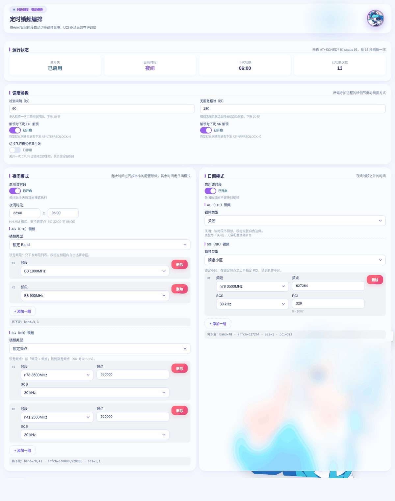
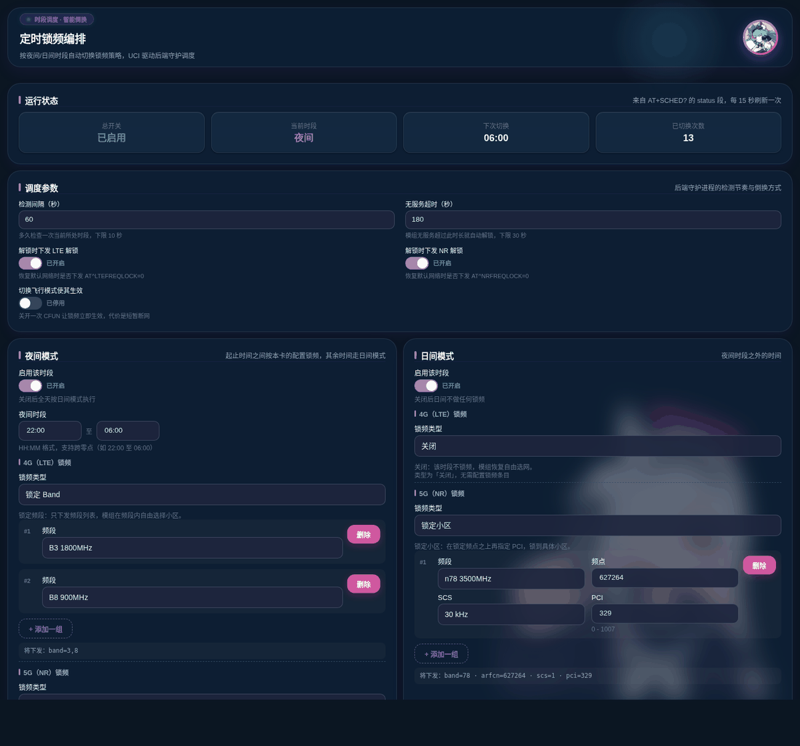
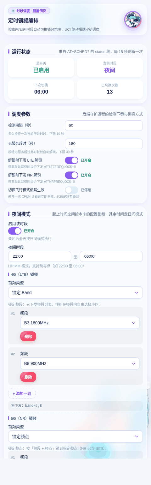
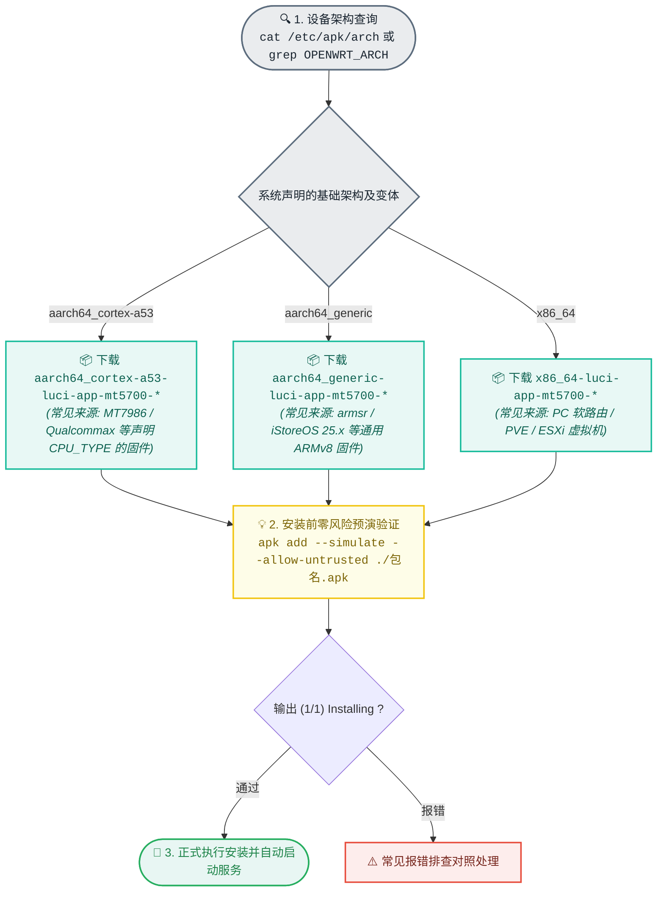

<div align="center">


# AT WebServer · MT5700M 5G 模组管理

**适用于 OpenWrt / ImmortalWrt 平台的 MT5700M 5G 模组全功能控制中心与常驻守护套件**

[](CHANGELOG.md)
[](https://github.com/LianXia233/luci-app-mt5700/actions/workflows/build-openwrt.yml)
[](https://github.com/LianXia233/luci-app-mt5700/actions/workflows/checks.yml)
[](LICENSE)

[](https://openwrt.org/)
[](https://immortalwrt.org/)
[](src/rust/)
[](https://github.com/LianXia233/luci-app-mt5700/releases)

[](https://lianxia233.github.io/luci-app-mt5700/)
[](https://github.com/LianXia233/luci-app-mt5700/stargazers)
[](https://github.com/LianXia233/luci-app-mt5700)
[](https://cnb.cool/LianXia233/luci-app-mt5700)

<p align="center">
  <b>📦 单包融合交付</b>：集成 12 个原生 LuCI 现代化管理页面与高性能常驻后端 <code>/usr/bin/at-webserver-rust</code><br>
  涵盖全自动 NDIS 拨号对账 · 真实射频打分看板 · 全网扫频 · 智能锁频 · 聊天式短信中心 · 交互式 AT 终端
</p>

</div>

---

> [!NOTE]
> **📌 仓库定位**
>
> - **GitHub 是主仓库**：[LianXia233/luci-app-mt5700](https://github.com/LianXia233/luci-app-mt5700) —— 源码、Issue 追踪、Release 发布均以此为准；
> - **CNB 是镜像仓库**：[cnb.cool/LianXia233/luci-app-mt5700](https://cnb.cool/LianXia233/luci-app-mt5700) —— 内容与主仓库保持同步，方便国内网络高速访问与固件包下载；
> - **提 Issue / 提建议请优先使用 GitHub**（[Issues](https://github.com/LianXia233/luci-app-mt5700/issues)）。

> [!WARNING]
> **⚠️ 独占运行与兼容性说明**
>
> 本插件是 MT5700M 专用拨号与管控插件，后端基于 Rust 独占持有模组 TTY 串口并直接调度 AT 事务。**本插件严禁与 QModem 等同样直接占用模组串口的插件同时运行**，否则会导致多进程争抢串口、AT 指令串流乱序、超时断线及拨号异常。
>
> **使用本插件即可独立完成接口创建、自动拨号、防火墙登记与掉线自愈**，无需安装或运行 QModem。安装本插件前请务必停用或卸载其他串口占用插件。

---

## 🌟 核心特性

| 特性维度 | 说明 |
|:---|:---|
| ⚡ **高性能异步常驻引擎** | 基于 **Rust + Tokio** 异步非阻塞事件驱动，常驻内存仅数十 KiB，内置无锁 AT 事务队列调度与优先级管理，杜绝多进程抢占 TTY 引起的数据截断与指令挂死。 |
| 🎯 **真实数据可信原则** | 严守四大铁律：**取不到如实说、缺口不连线、不估算速率、全链路可核对**。严格对照 3GPP 规范解析物理层射频指标，绝不注水或绘制伪造的平滑曲线。 |
| 🎛️ **12 大原生管理控制台** | 无缝融入 LuCI 原生路由菜单，覆盖网络状态仪表盘、APN 接入点、载波聚合、邻区扫频、定时锁频、模组升级、AT 终端等全生命周期功能。 |
| 💬 **现代聊天式短信中心** | 完整 PDU / Text 短信收发与长短信自动合并分段，呈现**双向 IM 聊天时间轴**；支持本地 ChaCha20 加密归档，模组闪存与路由存储无缝融合成单条时间轴。 |
| 🌐 **全自动拨号与全链路自愈** | USB NDIS / 转网口模式切换，承载网络链路状态守护与自动对账；缺失接口与防火墙 NAT 区域自动补齐，具备指数退避重拨与开机自启自愈。 |
| 🔔 **多通道多格式告警推送** | 支持**企业微信机器人**与 **QQ 机器人（官方 API v2）**，具备富文本 Markdown 表格卡片、内嵌跳转键盘与底部菜单，内置信号突变与定时巡检防刷屏节流保护。 |

---

## 📸 界面预览

### 网络状态控制台 (Dashboard)
控制台每秒采集模组底层射频指标，实时展示 RSRP、RSRQ、SINR、动态信号综合评分、5G NR 载波聚合状态、芯片微热力拓扑矩阵与动态 I/Q 星座图。

<div align="center">
  
  <p><sub>图 1：网络状态控制台（展示 AT 通道状态、信号质谱打分及 5G NR 载波聚合参数）</sub></p>
</div>

### 多端响应式与深浅色主题适配
页面支持纯 CSS 原生响应式与深色模式自适应，在桌面宽屏、平板以及移动端上均可自如操作。

| 🖥️ 桌面端宽屏布局 | 🌙 原生深色模式适配 | 📱 移动端自适应交互 |
|:---:|:---:|:---:|
|  |  |  |

<details>
<summary><b>🔍 查看看板实时细节、Tab 菜单增强与信号取数口径（点击展开）</b></summary>

> [!TIP]
> **Tab 菜单交互增强**  
> `admin/modem/5g` 下的 12 个页面共用 LuCI 原生 Tab 菜单，插件在加载后执行纯 DOM 增强（`at-webserver/tabmenu.js`，不修改 LuCI 核心与主题，不拦截点击）：
> 1. **横向滚动记忆保持**：在横向滚动主题下，切换、返回或刷新页面后，菜单会自动将当前选中项居中滚入可视区，不再重置到首项；用户手动滚动的偏移量会在 `sessionStorage` 中按路径记忆。
> 2. **统一矢量 SVG 图标**：12 个页签各配一枚 24×24 线性图标（`stroke=currentColor` 随主题自适应着色，桌面端 16px / 窄屏 15px），语义精准对应业务功能。

> [!NOTE]
> **信号指标取数来源（`AT^HCSQ`，鼎桥手册 13.5）**  
> 不同制式的字段数与顺序各不相同，插件严格按手册字段表解析：
>
> | 制式 | value1 | value2 | value3 | value4 |
> |:---|:---|:---|:---|:---|
> | `^HCSQ: "NR",…` | 5G RSRP | 5G SINR | 5G RSRQ | — |
> | `^HCSQ: "LTE",…` | LTE RSSI | LTE RSRP | LTE **SINR** | LTE RSRQ |
> | `^HCSQ: "WCDMA",…` | RSSI | RSCP | Ec/Io | — |
> | `^HCSQ: "GSM",…` | RSSI | — | — | — |
>
> 各字段为编码值（RSRP：`-140 + n` dBm；SINR：`-20 + 0.2n` dB；RSRQ：`-19.5 + 0.5n` dB；RSSI/RSCP：`-121 + n` dBm），`255` 表示未知或不可测（显示为「—」）。信号优先取 `^MONSC` 的驻留小区读数，缺项（如 4G 下的 SINR）由 `^HCSQ` 精准补齐。

</details>

---

## 🚀 快速安装与上手

### 1. 确认系统架构与环境

在目标路由器终端运行以下命令，确定包管理器与目标架构：

```sh
# 查看系统架构与版本
. /etc/openwrt_release && echo "系统: $DISTRIB_ID $DISTRIB_RELEASE"

# 检查架构（根据输出决定下载 aarch64_cortex-a53、aarch64_generic 或 x86_64）
[ -f /etc/apk/arch ] && head -n1 /etc/apk/arch || grep OPENWRT_ARCH /etc/openwrt_release
```

> [!WARNING]
> 切勿使用 `apk --print-arch` 判定。该命令返回的是 apk 工具本身的编译预设值，包管理器实际依据的是 `/etc/apk/arch` 的首行输出。

### 2. 软件包下载与安装

前往 [GitHub Releases](https://github.com/LianXia233/luci-app-mt5700/releases) 或 [CNB 镜像 Releases](https://cnb.cool/LianXia233/luci-app-mt5700/-/releases) 下载与架构匹配的安装包（主包 + 语言包）：

```sh
# -------------------------------------------------------------
# 【OpenWrt 25.x / ImmortalWrt SNAPSHOT / iStoreOS 25.x (apk)】
# -------------------------------------------------------------
apk add --allow-untrusted \
  ./<ARCH>-luci-app-mt5700-*.apk \
  ./<ARCH>-luci-i18n-mt5700-zh-cn-*.apk

# -------------------------------------------------------------
# 【OpenWrt 24.10 / ImmortalWrt 24.10 (opkg)】
# -------------------------------------------------------------
opkg install ./<ARCH>-luci-app-mt5700_*_<ARCH>.ipk
opkg install ./<ARCH>-luci-i18n-mt5700-zh-cn_*.ipk
```

### 3. 初始化配置与快速启动

安装完成后，执行以下指令完成初始参数提交与服务拉起：

```sh
# 1. 提交初始配置（默认启用自动探测 AT 串口）
uci set at-webserver.config.enabled='1'
uci set at-webserver.config.connection_type='SERIAL'
uci set at-webserver.config.serial_port='auto'
uci commit at-webserver

# 2. 启动服务并验证后端状态
service at-webserver restart
ubus call service list '{"name":"at-webserver"}'
```

进入 LuCI 侧边栏：**移动网络** → **5G 模组管理**（访问地址：`/cgi-bin/luci/admin/modem/5g`），即可开始使用。

<details>
<summary><b>📦 架构选型流程图、报错排查与稳定串口绑定（点击展开）</b></summary>



#### 常见包校验报错速查

| 终端报错输出 | 根因剖析 | 推荐解决方案 |
|:---|:---|:---|
| `error: uninstallable arch: aarch64_cortex-a53` | 固件声明架构为 `aarch64_generic` | 改下 `aarch64_generic` 安装包；或执行：<br>`echo aarch64_cortex-a53 >> /etc/apk/arch` |
| `error: uninstallable arch: aarch64_generic` | 固件声明架构为 `aarch64_cortex-a53` | 重新下载并安装 `aarch64_cortex-a53` 安装包 |
| `error: uninstallable arch: all` | 语言包架构未被识别 | 实测 apk-tools 3.0.5+ 已兼容；若报错执行：<br>`echo all >> /etc/apk/arch` |
| `luci-app-mt5700 (no such package): required by...` | 语言包依赖主包，未合并安装 | 将主包与语言包放入同一条 `apk add` 或 `opkg install` 指令中 |

#### 串口路径固化建议 (`/dev/serial/by-id/`)

`/dev/ttyUSB*` 的编号由内核枚举顺序动态决定，模组插拔或换口后可能发生序号漂移（例如 PC UI 口从 `ttyUSB1` 漂移为 `ttyUSB2`）。推荐在服务配置中指定稳定的 `by-id` 链接：

```sh
# 查看当前硬件稳定链接与 AT 口（if12 对应 PC UI / AT 口）
ls -l /dev/serial/by-id/

# 固化配置到 UCI
uci set at-webserver.config.serial_port='/dev/serial/by-id/usb-XXXX:XXXX-if12-<序列号>'
uci commit at-webserver
service at-webserver restart
```

</details>

---

## 🏗️ 系统拓扑与数据链路

整个系统采用清晰的三层解耦架构设计，确保 Web 响应敏捷、串口调度无冲突：

<div align="center">
  
</div>

1. **表现层 (LuCI WebUI)**：基于原生 JS (ES6) 与标准 LuCI 组件开发，纯 DOM / 矢量 SVG 驱动，不依赖重型框架；
2. **中间通信层 (rpcd ucode 代理)**：通过 `/usr/share/rpcd/ucode/mt5700.uc` 挂载至系统 rpcd，发布 `luci.mt5700.*` 接口，提供微秒级本地 IPC 转发与鉴权；
3. **核心守护层 (Rust/Tokio 常驻后端)**：`/usr/bin/at-webserver-rust` 独占控制串口设备，以异步事件循环处理 AT 交互、流量统计、自动拨号对账与事件推送。

### 自动拨号与全链路协同机制

数据面连通需经历从底层 AT 握手到操作系统网络协议栈的逐级对齐：

<div align="center">
  
</div>

#### 各环节协同机制与容灾方案

| 协作环节 | 负责组件 | 运行机制与容灾方案 |
|:---|:---|:---|
| **拨号开关与方式对齐** | Rust 后端 | 建立连接后强制核验；未达成执行指数退避重试（0/5/15/30/60/120s），每 5 分钟定时巡检对账 |
| **可用性双判决** | Rust 后端 | 联合校验 `AT^NDISSTATQRY?` 与 `AT+CGACT?` 双重指标，杜绝假死虚挂 |
| **承载接口拉起** | init.d + hotplug | 18 次 × 10s 间隔轮询保护；`hotplug.d/iface` 与 `hotplug.d/usb` 动态补发 `ifup` |
| **承载接口选择** | init.d | `iface_v4`/`iface_v6` 默认自动扫描：已挂在模组网口上的接口优先复用；支持手动指定 |
| **缺失接口补全** | init.d | 未找到可用接口且检测到硬件网卡时，自动创建 `MT5700M` 与 `MT5700Mv6` 接口并设为 `proto=dhcp` |
| **防火墙区域绑定** | init.d | 接口创建后自动登记至 `wan` 区域并重载 `fw4`，打通 `lan → wan` 的 NAT 转发规则 |

---

## 📊 功能矩阵 (12 大独立管理页面)

插件所有视图源码位于 `htdocs/luci-static/resources/view/at-webserver/`，各页面能力明细如下：

| 业务领域 | 页面名称 | 访问路径 | 核心能力说明 |
|:---|:---|:---|:---|
| 📡 **射频与基站** | **网络状态** | `admin/modem/5g/status` | 4 联射频仪表盘（RSRP / RSRQ / SINR / 综合信号评分）；**实时双 Y 轴趋势图**（支持质量底色、图例开关、缺口断点）；载波聚合（CA）频谱图；芯片 12 路微热力矩阵；MCS 动态 I/Q 星座图；**内核级流量火花线与设备侧使用量累计**（重启不丢失、定时清零）；SIM 签约速率（`^DSAMBR`）；双栈地址与驻网制式。 |
| | **网络设置** | `admin/modem/5g/network` | 5G / 4G 网络模式优先选择、SA / NSA 组网模式指定；APN 接入点分组配置（预设公众卡与物联网卡，精准剔除失效老 APN）。 |
| | **全网扫频** | `admin/modem/5g/scan` | 全频段或指定频段邻区基站快速扫描，物理层小区参数导出；扫频期间自动优雅暂离蜂窝数据并在完成后无缝复原。 |
| | **定时锁频** | `admin/modem/5g/schedule` | 支持锁定指定频段（Band）、频点（EARFCN）与基站物理小区 ID（PCI）；支持按日间/夜间时间策略自动轮转执行。 |
| 🌐 **数据与链路** | **拨号设置** | `admin/modem/5g/dial` | USB NDIS 拨号与转以太网口模式无缝切换；承载网络链路状态守护与自动对账。 |
| | **模组设置** | `admin/modem/5g/modem` | 模组核心硬件元数据查询（sysfs 零 AT 识别 USB 协商速率）；SIM 卡槽切换、热插拔与 PIN 码管理；载波聚合 / DSS / VoNR 射频特性控制；软硬件复位重启与出厂重置。 |
| | **模组升级** | `admin/modem/5g/firmware` | 模组新固件远程推送检测；本地固件升级包安全校验与刷写。 |
| 💬 **消息与运维** | **短信中心** | `admin/modem/5g/sms` | 支持 PDU / Text 短信收发与长短信自动合并分片；**聊天式 IM 会话界面**（双方头像、时间分隔、宽度随文收缩）；**发出记录本地 ChaCha20 加密归档**（路由闪存 2 MiB 循环配额，解决模组不写已发槽位的限制）；时间戳与 NTP 精确对齐；批量降序安全删除。 |
| | **短信设置** | `admin/modem/5g/sms-settings` | 自定义短信中心号码（SMSC，写入回读强校验）；存储介质切换（ME 模组 FLASH / SM SIM 卡）；USSD 快捷查询（话费/流量代码）。 |
| | **AT 调试终端** | `admin/modem/5g/terminal` | Web 原生交互式控制台，支持常用 AT 指令自动补全、历史回溯、原语调试与脱敏复制。 |
| | **运行日志** | `admin/modem/5g/log` | 后端环形缓冲区与系统 syslog 统一入口；日志分级细化（短信/拨号/网络/AT/系统）；支持关键词过滤与一键筛选「错误+警告」；通知记录留痕与企业微信/QQ 告警流追踪。 |
| | **服务配置** | `admin/modem/5g/config` | 常驻后端参数调优、串口绑定路径选择、自动拨号守护策略、退避重试阈值设置与自愈巡检总控。 |

> 📖 **进阶文档**：
> - [短信功能使用文档 (docs/sms-usage.md)](docs/sms-usage.md) —— 界面操作手册、关闭短信副作用、常见提示处置与验收清单。
> - [短信链路协议与命令参考 (docs/sms-at-protocol.md)](docs/sms-at-protocol.md) —— 3GPP PDU 编解码、三条链路的 AT 命令序列、三层超时预算与实机报文核对。

---

## 🎯 数据可信度与取数规范

本项目贯彻一条核心准则：**界面上的每一个数字，必须能无缝追溯至模组射频寄存器或内核原生计数器的真实读数**。

> [!IMPORTANT]
> **四大取数铁律**
> 1. **取不到如实说**：字段未上报或不可测时显示「—」或「未上报」，绝不使用 `Math.random()` 伪造，亦不使用其他参数勉强拼凑；
> 2. **缺口不连线**：信号趋势图某周期未能采集到有效读数时记录 `null`，绘图严格按断点断开，杜绝绘制伪造的平滑假线；
> 3. **实时速率精准计算**：由相邻两次内核统计计数器的真实增量除以物理时间差换算得出，绝不用累计值随意均摊；
> 4. **链路全透明可核对**：取数集中于标准 3GPP AT 命令与 sysfs 节点，任何维护者均可在路由终端自行复现验证。

### 核心指标取数对照表

| 监控项 | 取数来源 / 节点 | 备注与机制 |
|:---|:---|:---|
| RSRP / RSRQ / SINR | `AT^HCSQ`（手册 13.5） | 严格按制式解析字段表，`255` 编码值如实判定为不可测 |
| 驻留小区 / 频段 / PCI | `AT^MONSC` · `AT^HFREQINFO?` | 优先取 `^MONSC` 驻留小区，缺项由 `^HCSQ` 补齐 |
| 实时速率 / 本次使用量 | `/sys/class/net/<网卡>/statistics/{rx,tx}_bytes` | 经 rpcd `netrate` 读取内核计数器，**全程不下发 AT**，零串口负担 |
| 签约速率 (AMBR) | `AT^DSAMBR=<cid>`（手册 16.17） | 4G/5G 均可用；取不到时以 `AT+C5GQOSRDP` 的 Session-AMBR 兜底 |
| SIM 状态 / IMSI / ICCID | `AT+CPIN?` / `AT+CIMI` / `AT^ICCID?` | 状态机分层核对，防止误报就绪 |
| 芯片温度矩阵 | `AT^CHIPTEMP?`（手册 17.1.1） | 12 路硬件测温点逐路定级，仪表盘以**最高通道结温**评定整体散热 |
| 发射功率 | `AT^NTXPOWER?`（NR）/ `AT^TXPOWER?`（LTE） | NR 模式下 `AT^TXPOWER?` 恒报错属模组硬件正常行为 |

---

## 🔔 事件通知与远程告警

系统支持将模组硬件事件与链路状态实时外发至远程通道，支持**企业微信机器人**与 **QQ 机器人（官方 API v2）**。

### 事件类型与投递机制

| 事件类型 | 触发源 | 投递时效 | 机制说明 |
|:---|:---|:---|:---|
| **新短信到达** | 模组 URC `+CMTI:` | **即时直发** | 自动提取短信中心时间戳，长短信合并完成后即刻推送。 |
| **电话呼入** | 模组 URC `RING` | **即时直发** | 上报呼叫方号码与事件时刻。 |
| **短信存储告警** | 模组 URC `^SMMEMFULL` | **即时直发** | 存储区达到上限时告警，提醒清理避免漏收。 |
| **信号突变与网络切换** | 后端巡检（`notify_poll_*`） | **受限直发** | 仅在指定巡检时段生效；受 `notify_signal_min_interval` 最小间隔保护。 |
| **定时状态简报** | 定时器（`notify_timer_interval`） | **周期心跳** | 默认 10 分钟一次，上报当前网络质量快照与短信存储占用。 |

### QQ 机器人富文本卡片与防刷屏机制

- **Markdown 卡片模板**：推送新短信、巡检报告与切换提醒时，自动组装为包含二级标题、引用区与状态对比表的 Markdown 富文本卡片；
- **内嵌跳转键盘**：富文本底部可附带「打开管理页」一键跳转按钮（自动识别 `network.lan.ipaddr` 填充）；
- **二级防刷屏保护**：
  1. **信号通知最小间隔 (`notify_signal_min_interval`)**：默认 60 分钟，基线动态保留，彻底解决模组在 4G/5G 覆盖边缘来回跳水导致的频繁轰炸；
  2. **平台通道节流 (`qq_max_per_minute`)**：默认 10 条/分钟，超额消息进入滑动窗口排队发送，避免撞上 QQ 官方频控封禁。

---

## 🛠️ UCI 配置参考 (`/etc/config/at-webserver`)

以下为系统核心配置段的典型参考：

```ini
config at-webserver 'config'
    option enabled '1'                        # 服务总开关：1=启用，0=禁用
    option connection_type 'SERIAL'           # 通信模式：SERIAL(串口) / TCP(网络调试回环)
    option serial_port 'auto'                 # 串口绑定：auto(自动探测) / /dev/serial/by-id/* / /dev/ttyUSB*
    option autodial_enable '1'                # 自动拨号守护总控：1=启用，0=关闭
    option autodial_mode '1'                  # 拨号工作模式：1=USB网卡模式，2=转以太网口模式
    option iface_v4 'auto'                    # IPv4 承载接口：auto=自动复用/创建 / 接口名
    option iface_v6 'auto'                    # IPv6 承载接口：auto=跟随 IPv4 / none / 接口名
    option manage_interface '1'               # 接口纳管：1=缺失时自动建接口与绑定防火墙，0=纯手动
    option cellscan_timeout '180'             # 扫频超时保护阈值(秒)

    # --- 远程事件通知配置 ---
    option notify_enabled '1'                 # 事件通知总开关
    option notify_timer_interval '10'         # 定时状态报告推送周期(分钟，默认 10)
    option notify_signal_min_interval '60'    # 信号变化通知最小间隔(分钟，防刷屏保护)

    # 企业微信通道
    option wechat_enabled '0'                 # 企业微信推送开关
    option wechat_webhook ''                  # 企业微信群机器人 Webhook 地址

    # QQ 官方机器人通道 (API v2)
    option qq_enabled '0'                     # QQ 机器人推送开关
    option qq_app_id ''                       # 开放平台 AppID
    option qq_app_secret ''                   # 开放平台 AppSecret
    option qq_target_type 'c2c'               # 目标类型：c2c(单聊) / group(群聊) / channel(频道)
    option qq_target_id ''                    # 接收者 OpenID
    option qq_msg_format 'auto'               # 消息格式：auto(Markdown优先) / text
    option qq_keyboard_enabled '1'            # 是否附带内嵌跳转键盘
    option qq_max_per_minute '10'             # 官方主动消息每分钟节流阈值
```

---

## 📋 OpenWrt 版本兼容性与架构支持

| OpenWrt 版本 | 对应分支 | 包管理器 | 产物格式 | 支持状态 | 运行说明 |
|:---|:---|:---:|:---:|:---:|:---|
| **25.12.x** | SNAPSHOT (25.x) | `apk` | `.apk` | ✅ **官方 CI 构建发布** | 覆盖三档硬件架构；iStoreOS 25.x 完美兼容 |
| **24.10.x** | `openwrt-24.10` | `opkg` | `.ipk` | ✅ **官方 CI 构建发布** | 长期支持版，当前生产主力推荐 |
| **23.05.x** | `openwrt-23.05` | `opkg` | `.ipk` | ⚠️ 依赖满足，建议验证 | `luci-base` 自本代起内置 `rpcd-mod-ucode`，具备加载环境 |
| ≤ 22.03 | `openwrt-22.03` 及更早 | `opkg` | `.ipk` | ❌ **开箱不可用** | 默认缺少 `rpcd-mod-ucode` 运行环境，无法注册 RPC 接口 |

### 硬件架构覆盖

- **`x86_64`**：软路由、工控机、PVE / ESXi / Hyper-V 虚拟机；
- **`aarch64_cortex-a53`**：MediaTek Filogic (MT7981 / MT7986 / MT7988)、Qualcommax 等固件；
- **`aarch64_generic`**：Arm SystemReady (armsr / armv8)、通用 64 位 ARM 路由及 iStoreOS。

---

## 🧪 本地测试与质量保证

仓库配备了完善的前后端零依赖静态单测与端到端模拟用例，提交代码前可按以下命令进行验证：

```sh
# 1. 静态语法与代码规范检查 (无外部依赖，秒级完成)
node tests/static-check.js
for f in tests/*-test.js; do node "$f" || exit 1; done

# 2. Rust 后端编译与单元测试 (覆盖 AT 队列、PDU 编解码、环形日志与配额管理)
cd src/rust && cargo test --release && cargo clippy --release

# 3. 模组与 RPC 全链路端到端模拟测试 (mock-modem + 真实后端 + RPC 通信)
cd tests/mock-modem && sh run-e2e.sh
```

---

## ❓ 常见问题排错 (FAQ)

<details>
<summary><b>1. 为什么安装后打开页面提示「后端未就绪 / 连接被拒绝」？</b></summary>

请按以下顺序排查：
1. 检查后端服务是否正常运行：`service at-webserver status` 或 `ubus call service list '{"name":"at-webserver"}'`；
2. 检查系统中是否有 busybox 的 `nc` 命令：`which nc`（部分精简固件可能裁剪了 `nc` applet，导致 ucode 无法通过 socket 连接 Rust 后端）；
3. 检查串口是否被其他进程（如 QModem、minicom、chat 等）独占抢占；
4. 确认系统是否存在 `rpcd-mod-ucode` 插件（OpenWrt 23.05+ 默认提供）。

</details>

<details>
<summary><b>2. 为什么提示「有 IP 地址却无法上网」？</b></summary>

1. 检查防火墙 NAT 区域：在终端执行 `uci show firewall | grep 'network=.*MT5700M'`，确认 `MT5700M` 承载接口已正确登记入 `wan` 防火墙区域；
2. 执行一键接口与防火墙自愈脚本：`/etc/init.d/at-webserver ensure_interfaces`；
3. 查看当前 nftables 规则是否包含模组接口：`nft list chain inet fw4 srcnat`。

</details>

<details>
<summary><b>3. 为什么与 QModem 互不兼容？</b></summary>

MT5700M 模组只有一个主控制 AT 串口（PC UI）。QModem 与本插件均需要独占该串口下发业务控制指令。若两者同时常驻，会造成指令交叉穿插、回执匹配错位（如将短消息应答当成拨号应答）甚至引起模组通信通道死锁。使用本插件无需配合 QModem。

</details>

---

## 📄 许可证与开源声明

本项目遵循 **GNU General Public License v3.0 (GPL-3.0-only)** 开源协议发布，完整条款见根目录 [`LICENSE`](LICENSE)。

### 角色素材与知识产权声明

本项目界面中引用的看板娘角色「薄荷」（Mint）为游戏《异环》（NTE / Neverness to Everness）的登场角色：
- **版权所有**：苏州幻塔网络科技有限公司（Hotta Studio）/ 完美世界游戏；
- **使用边界**：相关素材仅以聚合形式用于非商业个人开源项目的界面交互点缀，本项目不主张任何角色形象权利。完整素材指纹与权利说明见 [`THIRD-PARTY-NOTICES.md`](THIRD-PARTY-NOTICES.md)。

### 商标与指称使用

`OpenWrt`、`ImmortalWrt`、`LuCI`、`MT5700M` 等商标与标识均归各自权利人所有。本仓库中对相关名称的引用仅用于客观指示运行平台、系统组件及硬件型号，不代表任何形式的官方背书或授权合作。

### 项目维护者

**Copyright (C) 2026 [LianXia233](https://github.com/LianXia233/luci-app-mt5700)**. All rights reserved.
